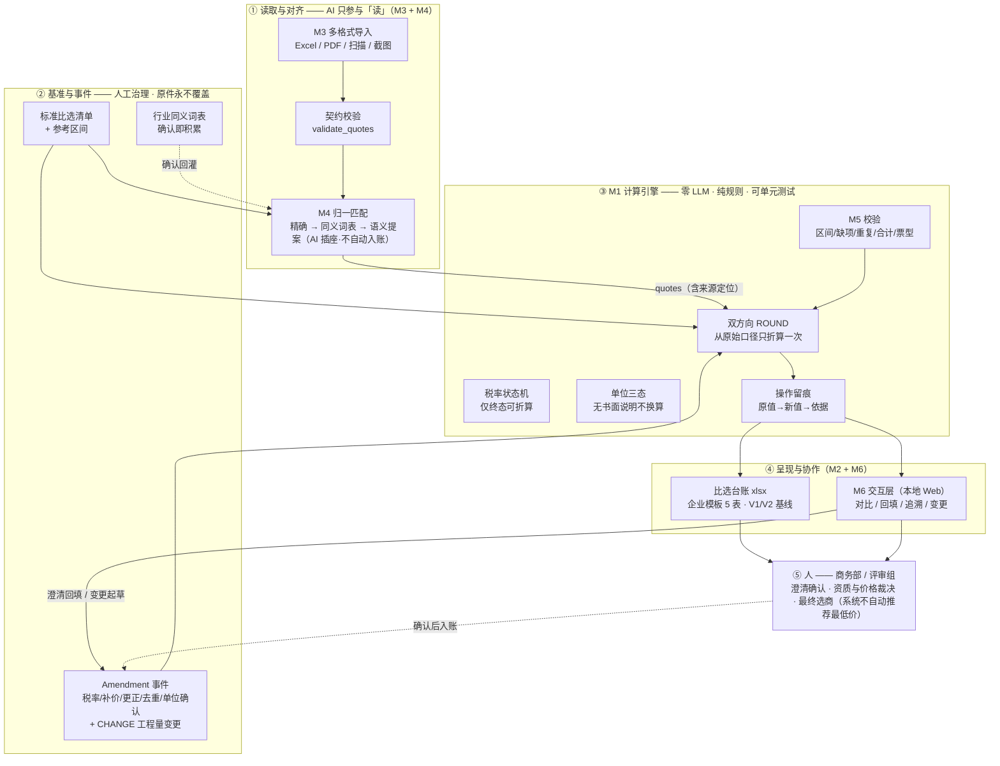

# 分包比选对账 Agent · M1 引擎 + M2 台账 + M5 校验 + M4 归一匹配 + M6 交互层

项目 GC-017（上海山南勘测 · 分包比选）三权分立架构中的 **"算"**、**"出成果"**、**"举旗"**、**"对齐"** 与 **"协作"**。
金额计算 **零 LLM 参与**，全程 Decimal，可单元测试，可离线内网部署（engine/matching/tools/webapp 仅用 Python 标准库；M2 写 xlsx 用 openpyxl）。

## 系统架构



（PPT/汇报用 ORBIS 规范架构图：`docs/architecture.html`，浏览器打开后截图即可。）

## 目录结构

```
agent/
├── engine/                  # M1 计算引擎（纯标准库）
│   ├── money.py             #   Decimal + ROUND 半进一（与 Excel ROUND 语义一致）
│   ├── models.py            #   报价行(冻结)/税率状态机/单位口径状态机/来源定位
│   ├── calculator.py        #   双方向 ROUND 公式、逐行旗标
│   ├── ledger.py            #   台账装配：事件应用、合计、操作留痕
│   ├── loader.py            #   JSON 数据装载
│   └── units.py             #   单位口径（与税率状态机同构，骨架复用）
├── report/                  # M2 台账生成器
│   └── xlsx.py              #   Ledger → 《比选输出模板》5-sheet xlsx（模板副本填写）
├── matching/                # M4 归一匹配
│   ├── matcher.py           #   三层匹配：规范化精确 → 同义词表 → 语义提案（AI插座，不自动入账）
│   └── pipeline.py          #   批量归一 + 疑似重复标注 + 评审清单 + 确认回灌词库
├── data/                    # GC-017 结构化兜底数据（M3/M4 产物同构）
│   ├── gc017_catalog.json   #   统一清单 C01–C15 + 参考区间
│   ├── gc017_quotes.json    #   甲乙丙丁原始报价（含列示差错，照原样录入）
│   ├── gc017_events.json    #   CLARIFY-01 / CHANGE-01 结构化事件
│   ├── gc017_qualifications.json  # 资格材料登记（缺件/疑点）
│   └── synonyms.json        #   行业同义词表（人工确认即积累，跨项目复用）
│   └── kb_cases.json        #   案例库种子：GC-017 异常/澄清/匹配先例 11 条（结案归档）
├── kb/                      # 知识层：异常案例/澄清先例检索 + 同义词 few-shot（给 AI 的提示，非裁决）
│   └── store.py             #   related_item / hints_for_match / precedents_for_clarify / 人确认写入闸门
├── tests/                   # 88 个单元测试（unittest 标准库）
├── run_gc017.py             # M1 全量回归：V1 原始 → V1 澄清后 → V2 变更后
├── gen_workbooks.py         # M2+M5 入口：三阶段 → 三份比选台账 xlsx
├── run_m4.py                # M4 入口：归一匹配 / --confirm 回灌词库
├── tools/validate_quotes.py # M3 输出契约校验器（内网可用，纯标准库）
├── docs/M3输出格式规范.md    # M3→M4→M1 数据契约（含硬约束清单）
└── out/                     # 导出的三版台账 JSON + xlsx
```

## M6 人机协作界面（本地交付）

本地 Web 交互层（对比表追溯 / 待办一键回填 / 硬规则现场拦截 / 工程量变更 V2 / 操作留痕 / 导入导出），
按 ORBIS CI 规范实现，**代码为本地交付，暂不入库**；架构见上方 Mermaid 图与 `docs/architecture.html`。

## 知识层 kb（历史数据 → AI 的提示）

三权分立中 AI 的两个插座（M4 语义提案、澄清起草）由知识层供弹。**检索结果只是提示，先例不构成裁决**（规则五/七）；**写入必须带 `confirmed_by`**（人确认闸门，飞轮的质量生命线）。

- **案例库** `data/kb_cases.json`：异常案例 / 澄清先例 / 匹配先例，GC-017 的 11 条结案归档做种子
  （超区间→商务保留原报价、重复→只计一次、附件未并入→加计、项≠台班→书面确认均分……），
  每条 = 现象 → 澄清 → 结论 → 教训 → 依据，来源可溯；
- **检索**：纯规则（标签 + 二元组重合打分），内网零依赖；`related_item(item, supplier)` 供追溯面板、
  `precedents_for_clarify(text)` 供澄清起草、`hints_for_match(name)` 供语义提案 few-shot；
- **接线点**：M4 `propose(name, catalog, kb)` 提案时附"知识库提示"（历史确认映射 + 匹配先例）——
  提示不改变"只提案不回填"的纪律；M6 追溯面板对每个单元格显示"知识库先例（提示 · 非裁决）"；
- **企业落地**：检索器原位替换为本地向量库（faiss/chromadb），接口不变；结案归档动作
  （成交价 + 最终台账 + 澄清结论）即知识库的日常进料。

- **三层递进，只有确定性两层允许自动回填** `item`：
  1. 规范化精确（全角/半角、空白、括号后缀归一后与清单名全等）；
  2. 同义词表（`data/synonyms.json`，每条带确认人与依据）；
  3. 语义提案——**只出候选进评审清单，永不自动入账**。当前为字符相似度占位，
  `matching/matcher.py::propose()` 是 AI 插座：内网本地 LLM 部署后原位替换该函数即可，接口不变。
- **飞轮**：`python run_m4.py --confirm "原始名" C03 "依据"` 人工确认 → 写入词库 → 下个项目自动命中；
- 疑似重复只标注不删除（两行都标，去重由商务澄清/引擎处理）；M3 已给编号的行视为已确认，不重算；
- 输入文件永不改写，结果写 `*_matched.json` + `out/m4_review.json`（待人工确认清单）。

## M5 校验与异常（规则第五条：只举旗，不裁决）

| 校验项 | 位置 | 说明 |
|---|---|---|
| 参考区间外 | engine/calculator | 同范围同单位的**未税单价**层比对（含税单价先折未税；原报未税的税率未声明也可比；单位未书面确认不可比；整项口径经确认产生单价后恢复可比）。超上限标倍数、低于下标标百分比并提示"警惕漏项少测"——**只提示不自动改写**。GC-017 全量 15×4 行有且仅有乙 C08 一处（500 vs 上限102，约4.9倍） |
| 缺项/单价未填 | engine/ledger | 占位行"未报"，不计入合计（未知≠0） |
| 重复行 | engine/ledger | 同分项多行提示，澄清前按列示原样计入 |
| 合计误差 | engine/ledger | 明细加总 vs 原报列示合计（乙 +200、丙 +20） |
| 列示金额≠乘积 | engine/calculator | 抄写差错线索（丙 C04 +20） |
| 数量与清单不符 | engine/calculator | 单位一致时才比数量 |
| 发票类型未说明 | report/xlsx | 专票可抵扣比未税、普票含税即成本——税率已声明但未说明票型的供应商各立一项（M5 口径校验） |

M5 补充事项闭环纪律：区间/发票/资质类事项**不因变更留痕误关**（闭环只认 CLARIFY-01 依据）。

## 实现的业务规则（对照《项目范围与计算规则》七条）

| 规则 | 实现 |
|---|---|
| 一 工作量以清单为准 | 数量与清单不符出旗标；不允许自行改变工程量 |
| 二 税率未给不得默认补写 | 税率状态机：未声明→(待澄清)→已声明/已澄清，仅终态可折算；未声明行显示"不可折算"，不当 0 |
| 三 双方向 ROUND 公式 | 原报含税：未税=ROUND(含税/(1+税率),2)；原报未税：税额=ROUND(未税×税率,2)。恒从原始口径起算，只折算一次防舍入漂移 |
| 四 台班≠项、未知≠0 | 单位口径状态机：无书面说明不得换算；单价缺失→"未报"，不计入合计 |
| 五 参考区间仅提示 | 区间已随清单入库（`range` 字段），比对与提示归 M5 |
| 六 原件永不覆盖、全程留痕 | QuoteLine 冻结；澄清/变更是 Amendment 事件，build 时克隆应用；每条留痕含 原值/新值/依据/时间/操作者，字段与台账模板「操作记录」sheet 对齐 |
| 七 人裁决、不自动推荐 | 引擎只算账出旗标，不排序不推荐（选商属 M6/人） |

## 运行

```bash
cd agent
python -m unittest discover -s tests   # 42 个单测（引擎 34 + 台账 8）
python run_gc017.py                    # M1 三阶段回归 + 底稿核对 + JSON 导出
python gen_workbooks.py                # M2 生成三份比选台账 xlsx 到 out/
```

## M2 台账生成器设计要点

- **模板保真**：表头与《比选输出模板.xlsx》逐字一致；找到企业模板文件时在其副本上填写（保留原格式），
  独立检出（如 GitHub）时按模板表头新建；
- **三版台账互不覆盖**：V1 原始 / V1 澄清后 / V2 变更后 各一份 xlsx，V1 基线保留（规则第六条）；
- **需补充事项跨版本累计**：问题清单固定从 V1 原始台账生成（避免旗标消除后事项消失），
  处理状态再对当前版本求值——已澄清的显示"已澄清关闭"并附依据，未决的保持"待补充"；
- **闭环判定只认 CLARIFY-01 依据**：CHANGE-01 工程量变更留痕不会误关异常事项（乙 C08 区间异常
  在 V2 中依然开放）；乙 C08 异常、乙/丁资质事项按澄清与变更纪要保持未关闭；
- **税率/合计类事项按供应商折叠**，不逐行刷屏；资格缺件/疑点入「需补充事项」且保持开放，
  「资格材料清单」保留登记原文（系统只整理缺件与疑点，有效性由评审人员判断）；
- V2 对比表附「较V1差异」行，落实变更通知"保留 V1 基线与金额差异"的要求。

## GC-017 底稿数字（回归基准）

| 阶段 | 甲(含税) | 乙(未税) | 丙(含税) | 丁(含税) |
|---|---|---|---|---|
| V1 原始 | 40,545.00 | 58,175.00（列示 58,375.00，差 +200） | 38,485.84（列示 38,505.84，差 +20） | 41,924.08 |
| V1 澄清后 | 40,545.00 | 62,747.00（含税 66,511.82） | 41,877.84 | 42,166.60 |
| V2 变更后（C08 60→72根） | 41,626.20 | 68,747.00 | 42,991.44 | 43,291.00 |

V1 原始阶段引擎当场抓出的错：乙 C07 重复两行、乙 C09/C11 漏报、乙列示合计差 +200、
乙税率未给（14 行含税不可折算）、乙 C08 未税 500 元/根（超区间线索，M5）、
丙 C04 列示比乘积多 +20.00、丙 C13 附件 3,392.00 未并入、丁 C04 数量 16≠18、
丁 C14 按项报（单位待澄清）。澄清后：丙 C13 并入（未税 3,200.00+税额 192.00）、
丁 C14 确认 1 项=4 台班均分 771.68（总额 3,086.72 不变）。

## 与其余模块的接口

- **上游 M3/M4**：产出与 `data/gc017_quotes.json` 同构的 JSON（含来源定位），即可进引擎；
- **M2**：`gen_workbooks.py` 消费 `Ledger` 产出 5-sheet 台账 xlsx（对比表/需补充事项/操作记录/报价明细/资格材料清单）；
- **M5**：消费同一 `Ledger` 的 `flags` 与 `catalog.range` 出异常提示（乙 C08 区间线索现挂行备注）；
- **M6**：`LedgerBuilder.build()` 天然多版本（V1/V1澄清/V2 互不污染），回溯用 `ComputedLine.source`；
  需补充事项的"累计+闭环"模式（`issue_source`）即人机协作循环的台账表达。

## 已知边界

- 单位确认换算目前只支持"整项均分"口径（丁 C14 场景）；有单价口径的换算留待后续案例；
- `stated_amount`（列示金额）只作比对基准，计算恒用 ROUND(数量×单价,2)——这正是抓出
  丙 C04 +20、乙合计 +200 的机制；澄清更正数量/单价时金额联动按乘积重算；
- 资质有效性、价格合理性、最终选商不在引擎职责内（三权分立之"人"）。
